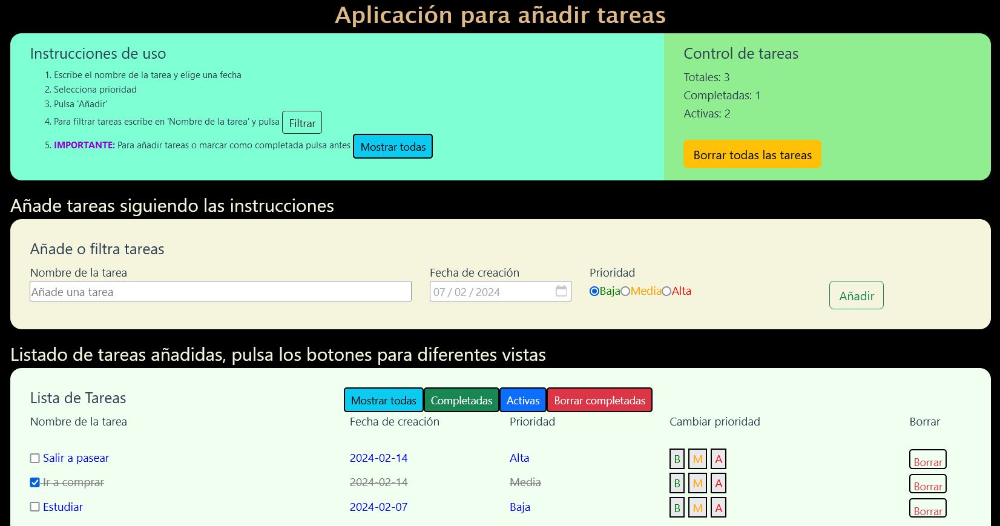

# To-Do List App
Aplicación de tareas desarrollada con Vue 3 y Vite. Esta es la versión de diseño moderno, mantenida en la rama `vue-version-formato-moderno`; la rama `main` conserva la versión original.

## Requisitos
- Node.js y npm.

## Desarrollo local

Desde esta carpeta (`to-do-list/`), instala las dependencias y arranca el servidor de desarrollo:

```sh
npm install
npm run dev
```

## Compilar y publicar

Genera la versión de producción con:

```sh
npm run build
```

Vite crea los archivos en `dist/`. La ruta base está configurada como `/todolistia/`; copia **el contenido** de `dist/` directamente a `httpdocs/todolistia/` en el servidor. El `index.html` debe quedar en esa carpeta, no dentro de una subcarpeta `dist`.

## Funcionalidades
- Añadir tareas con prioridad y fecha.
- Cambiar la prioridad de las tareas.
- Marcar tareas como completadas.
- Filtrar tareas totales, completadas o activas.
- Eliminar tareas.
- Buscar tareas por nombre.

## Vista previa

